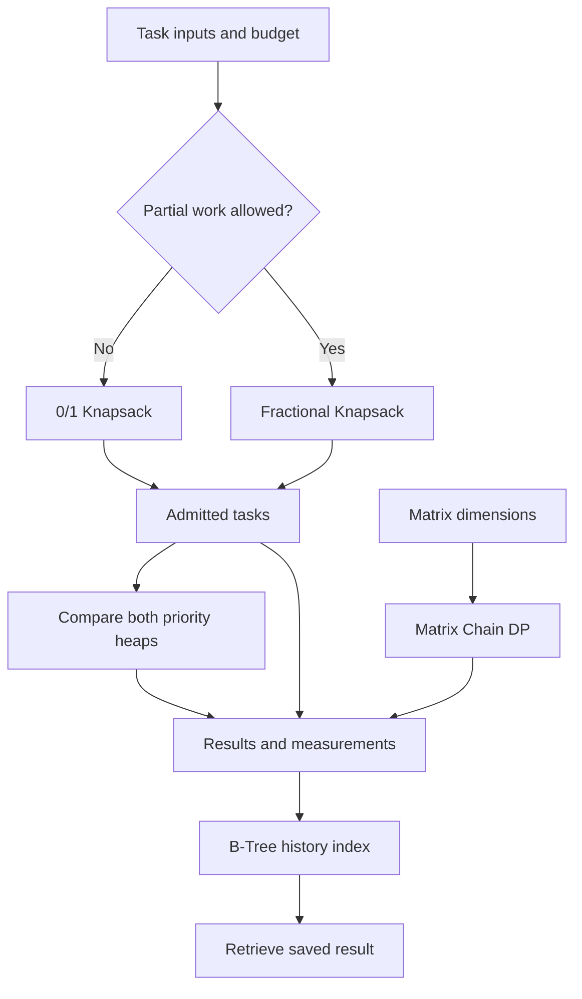

# CPU Workload Planner

Thermal-Aware CPU Workload Optimization Framework — DAA Assignment 2.
A simple browser prototype with four steps and actual syllabus algorithms.

## Open on Mac or Windows

Extract this folder. Open `dist`, then double-click `index.html`.
No Python, installation, server, account, internet or paid tool is required for the app.
Keep `index.html`, `style.css`, `algorithms.js` and `app.js` together.
If your browser blocks local storage, calculations still work and results can be downloaded.

## What to explain

“Our prototype selects useful tasks within a resource limit, finds a cheaper matrix
multiplication grouping, handles changing job urgency, and retrieves saved results.”

1. **Choose tasks:** budget 5, partial tasks off → benefit 9. Turn partial tasks on
   and choose again → benefit 9.8. The changed condition selects a different algorithm.
2. **Reduce calculations:** run the preset → 27,000 versus 4,500 scalar multiplications.
3. **Manage priority:** return to tasks; budget 15, partial off, choose again. Make
   Data processing urgent in step 3. Image batch is dispatched first; Data processing
   then moves ahead of Matrix analytics. Both heaps perform the same workload.
4. **Previous results:** choose a saved entry; Find result uses the B-Tree index.

Use “Viva help” for the short presentation and complexity notes. Expand algorithm
or heap comparison details only when explaining the technical implementation.

## Files and code

- `dist/index.html`: page structure and viva help.
- `dist/style.css`: layout and responsive styling.
- `dist/app.js`: interface events, connected admitted-job queue, storage and history.
- `dist/algorithms.js`: actual 0/1 DP, fractional greedy, matrix-chain DP, Binomial
  Heap, Fibonacci Heap with circular rings/cascading cuts, and minimum-degree-3 B-Tree.
- `tests.cjs`: independent oracles, randomized heap operations and B-Tree invariants.
- `experiments.cjs`: repeatable workload experiments.
- `experiments.csv`: real measurements from the development environment.
- `validation.txt`: test output and verification limits.

The app is entirely client-side JavaScript. There is no Python backend in this version.

## Model and correctness

Each independent job has integer cost c > 0, benefit v >= 0 and priority p >= 1.
Maximize sum(v*x) subject to sum(c*x) <= W. Whole jobs use x in {0,1}; partial jobs
use 0 <= x <= 1 and assume linear benefit. DP compares inclusion/exclusion and
reconstructs the optimal whole-job subset. Fractional sorting by v/c is justified by
exchanging a lower-ratio portion for an available higher-ratio portion.

Matrix dimensions define conformable matrices in fixed sequence. DP tries every
final split of each interval, combining optimal subchains to minimize scalar
multiplications. The matrix module is a separate workload-cost example; it does not
silently convert multiplication counts into job cost or temperature.

Both heaps maintain parent-child heap order and support insertion, extract-min and
decrease-key. The urgency button uses key 0, below all user-entered priorities. Heap
comparison measures identical workloads. B-Tree splitting maintains ordered keys
and equal leaf depth. Browser localStorage persists records; an in-memory B-Tree is
rebuilt on startup. Storage writes and UI rendering are separate from index complexity.

## Complexity and limitations

n = tasks; W = integer capacity; m = matrices; r = saved records.

| Component | Time | Space |
|---|---|---|
| 0/1 Knapsack DP | O(nW), pseudo-polynomial | O(nW) |
| Fractional Knapsack | O(n log n) | O(n) |
| Matrix Chain Multiplication | O(m^3) | O(m^2) |
| Binomial insert/decrease/extract | O(log n) worst case | O(n) total |
| Fibonacci insert/decrease/extract | O(1) / O(1) amortized / O(log n) amortized | O(n) total |
| Fixed-degree B-Tree search/insert | O(log r) | O(r), excluding record contents |

General 0/1 optimization is NP-hard and its decision form is NP-complete. Numeric
capacity DP is pseudo-polynomial. Do not label the whole framework NP-hard.
All bounds use standard unit-cost arithmetic assumptions. Limits keep number
magnitudes safe and the classroom interface responsive: 100 jobs, budget <= 5000,
30 matrices, dimensions <= 10000, latest 200 history entries.

This is a simulation: costs/benefits are assumed; no temperature is measured, no
hardware is controlled and admitted application jobs are not actually executed.
Matrix savings do not establish a temperature reduction. There are no job dependencies,
deadlines or multicore placement. Heap timings vary with browser and workload;
structural counters represent different kinds of operation and should not be summed
as equal CPU work. File-based browser history may differ from hosted-site history.

## Test and experiment evidence

If Node.js is available, open a terminal in the extracted project directory:

    node tests.cjs
    node experiments.cjs

Node is needed only to rerun tests/experiments, not to open the app. The test suite
checks small knapsack problems against exhaustive choices, matrix DP against recursive
enumeration, interleaved heap updates against a reference map, B-Tree invariants and
search, boundary/invalid/large inputs, and the connected priority example.
Experiments include normal, boundary, difficult and large workloads, matrix chain
length growth, heaps with different priority-update frequencies, and B-Tree growth.
Seven repetitions are measured and median time reported. Regenerate on your laptop
for machine-specific evidence; do not present development timings as laptop timings.
Graphical browser QA was unavailable in the build environment; verify the four demo
steps in your browser before presenting. Algorithm and syntax tests passed.

## GitHub submission

Create a repository for this project and upload the extracted contents, preserving
the `dist` folder and its files. Include this README, tests, experiment code/results,
and a few demonstration screenshots. Do not upload only the ZIP: the teacher should
be able to open the source files. You do not need to publish GitHub Pages to submit
code. The app runs by opening `dist/index.html` locally.

The two-page faculty submission form, team member details, repository URL and any
specific LeetCode requirements remain separate submission steps.

## Architecture

